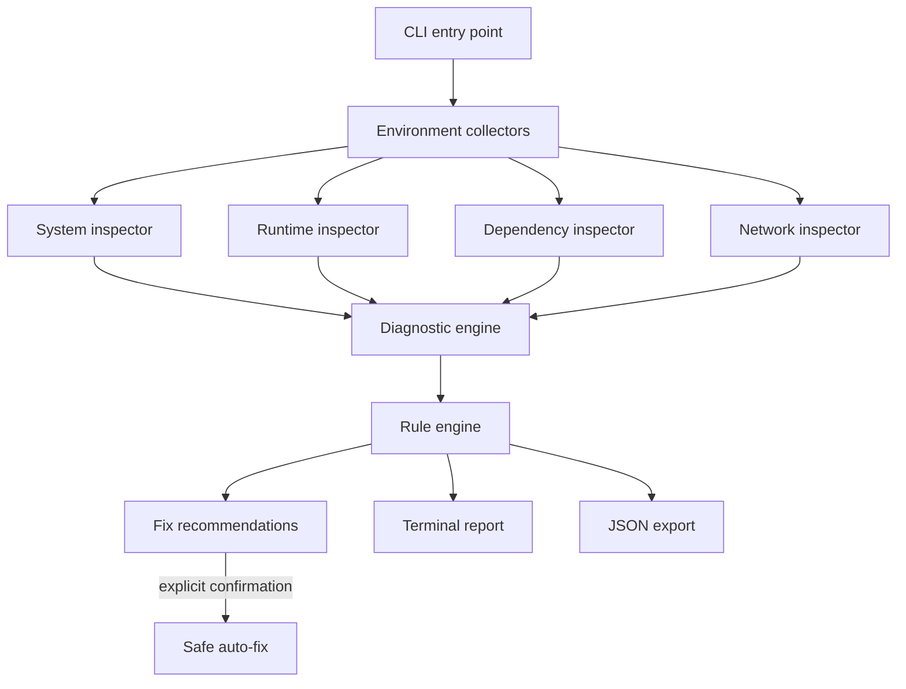

# EnvDoctor

> A cross-platform CLI that detects, diagnoses and helps resolve development environment problems.


[](LICENSE)


**Status: M1 (v0.1.0).** EnvDoctor collects platform, shell and PATH facts and prints them as text or JSON,
with a documented exit-code contract. **There are no diagnostic rules yet**, so it cannot tell you that
anything is wrong: `diagnose` lists facts and then reports zero findings. Nothing is modified on your machine.

## Why this exists

"Works on my machine" is usually a PATH problem, a port conflict, a stale Node version manager,
a Docker daemon that is not running, or a missing system library. Developers lose hours to this and the
existing answers are scattered forum posts. EnvDoctor collects the evidence, applies explicit rules, and
explains the cause instead of dumping raw output.

## What it will do

| Capability | Milestone | Status |
|---|---|---|
| Detect conflicting Python and Node versions | M2 | Not started |
| Identify broken PATH entries | M2 | Facts reported; no rule yet |
| Detect port conflicts | M2 | Not started |
| Diagnose Docker daemon problems | M3 | Not started |
| Identify missing system dependencies | M3 | Not started |
| Detect incompatible package managers | M3 | Not started |
| Check Git configuration | M2 | Not started |
| Generate diagnostic bundles | M4 | Not started |
| Human-readable reports | M4 | Basic text report (M1); polish is M4 |
| JSON export | M1 | **Done** |
| Safe, opt-in automated remediation | M5 | Not started |
| Windows, Linux and macOS support | M6 | Collectors build for all three; CI matrix not yet run |

## Architecture



Full reasoning, data model, API surface and failure behaviour are in [docs/PLAN.md](docs/PLAN.md).

## Engineering challenge

Supporting three operating systems without platform-specific assumptions leaking into the
diagnostic engine. Collectors are platform-specific; rules are not. No rule may shell out to a tool that
might not exist, and no fix may run without explicit confirmation.

## Quickstart

Requires Go 1.26+.

```bash
make build
./bin/envdoctor diagnose
```

```
EnvDoctor 0.1.0 - environment diagnosis
Generated 2026-11-13T01:41:49Z

Platform   windows 11 (build 26300) amd64
Elevated   no
Shell      powershell
PATH       26 entries, 2 missing, 0 duplicate

Missing PATH entries:
  -  C:\Windows\System32
  - ~\AppData\Local\Programs\Antigravity\bin

Rules      0 registered in this build

No findings.
```

That output is real, captured from `goreleaser build --snapshot` on Windows 11 while developing M1. The
leading space in the first entry is part of the value: it is a malformed PATH element, and that is exactly
what the collector is for.

Machine-readable output, for an editor or CI:

```bash
./bin/envdoctor diagnose --json
```

The JSON document is validated against [docs/schema/diagnose-v1.schema.json](docs/schema/diagnose-v1.schema.json)
in the test suite; the snapshot inside it is described by
[docs/schema/snapshot-v1.schema.json](docs/schema/snapshot-v1.schema.json). Home directories are replaced
with `~` before anything is written.

Exit codes: `0` nothing at or above warning, `1` warnings, `2` at least one error, `3` the tool itself failed
(including a collector timeout), `4` invalid usage. Today only `0`, `3` and `4` are reachable, because zero
rules are registered.

`--component` and `--rule` narrow which rules are evaluated. With no rules, either flag can only produce an
empty result or an "unknown rule" error.

A local release build of all six targets:

```bash
goreleaser build --snapshot --clean
```

`goreleaser check` additionally wants a git remote, so it only passes once the repository is pushed.

## Repository layout

| Path | Purpose |
|---|---|
| `cmd/envdoctor` | CLI entry point |
| `internal/cli` | Command wiring, flags, exit codes |
| `internal/config` | Resolved options, schema version, collector timeout |
| `internal/collector` | Collector interface, registry, parallel runner |
| `internal/collector/{windows,linux,darwin}` | Reserved for build-tagged collectors (empty in M1) |
| `internal/diagnostic` | Rule engine, severity model, fixture harness |
| `internal/report` | Terminal renderer, JSON renderer |
| `internal/fix` | Remediation plans, dry-run by default (empty until M5) |
| `internal/system` | Thin wrappers over OS facilities, the only place syscalls live |
| `docs/schema` | Committed JSON schemas, enforced by tests |
| `tests/golden` | Snapshot-to-diagnosis fixtures, one per rule |
| `deploy` | Release and packaging notes |

## Roadmap

| Milestone | Deliverable | Status |
|---|---|---|
| M1 | CLI foundation, collector interface, system information | **Done** (v0.1.0) |
| M2 | Cross-platform collectors: runtimes, PATH, ports, Git | Not started |
| M3 | Rules ENV007–ENV012, Docker and dependency inspectors, `explain` | Not started |
| M4 | Polished terminal output, Markdown export, diagnostic bundles | Not started |
| M5 | Safe, confirmed automated remediation | Not started |
| M6 | Windows, Linux, macOS packaging and signed releases | Not started |

This roadmap mirrors [docs/PLAN.md](docs/PLAN.md) section 12. If the two disagree, the plan is correct and
the README is a bug.

## Project standards

- Conventional Commits, Semantic Versioning, `main` is always green.
- Every release is produced by CI, never by a laptop.
- Status claims must match reality. Unbuilt features are marked "Not started", not "coming soon".
- Decisions are recorded as ADRs in [docs/adr/](docs/adr/).

## Contributing

Read [CONTRIBUTING.md](CONTRIBUTING.md) and [docs/PLAN.md](docs/PLAN.md) first. Issues labelled
`good first issue` are scoped for a first pull request.

## Using an AI assistant on this repository

Read [docs/PLAN.md](docs/PLAN.md) end to end, including the machine context block at the top. It states
what exists, what does not, and which claims are forbidden. Do not describe planned behaviour as
implemented behaviour.

## License

MIT - see [LICENSE](LICENSE).
