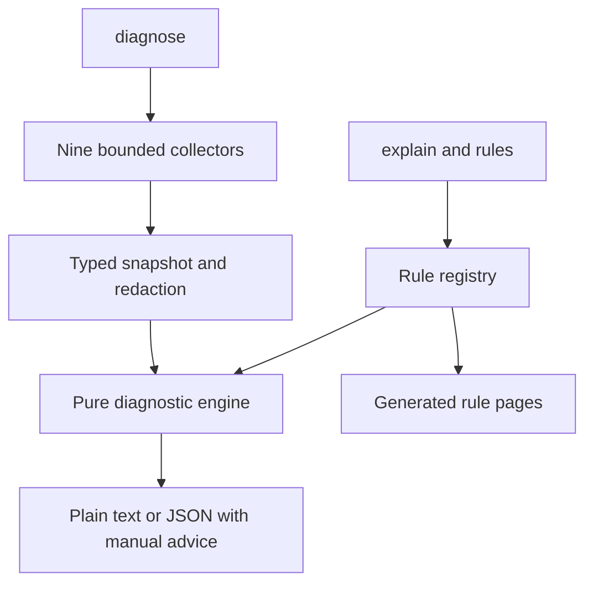

# EnvDoctor

> A cross-platform CLI that detects, diagnoses and helps resolve development environment problems.


[](LICENSE)


**Status: M1–M3 complete and merged into main; Windows, Ubuntu and macOS CI passed.**
Nine collectors feed twelve rules covering platform, shell, PATH, Python/Node runtime, requested TCP ports,
effective Git config, local Docker/API metadata, explicit project dependencies and proxy configuration.
Reports are plain text or versioned JSON; `explain` and `rules --json` work offline.
Diagnosis never applies fixes or executes interpreters found on PATH. The
[M3 validation record](docs/testing/m3-validation.md) records commands, live checks and limits.

## Why this exists

"Works on my machine" is usually a PATH problem, a port conflict, a stale Node version manager,
a Docker daemon that is not running, or a missing system library. Developers lose hours to this and the
existing answers are scattered forum posts. EnvDoctor collects the evidence, applies explicit rules, and
explains the cause instead of dumping raw output.

## What it will do

| Capability | Milestone | Status |
|---|---|---|
| Detect conflicting Python aliases and Node candidates | M2 | **Done**, when metadata provides the required evidence |
| Identify broken PATH entries | M2 | **Done** (raw entries preserved after home redaction) |
| Detect requested TCP port conflicts | M2 | **Done**, owner PID/name where permitted |
| Detect unreachable local Docker engine | M2 | **Done** (ENV006) |
| Inspect Docker contexts and API compatibility | M3 | **Implemented**, default local probe and known API bounds |
| Identify missing system dependencies | M3 | **Implemented**, supported requirements explicitly declared by a project |
| Detect incompatible package managers | M3 | **Implemented**, explicit manager evidence and observed lockfiles |
| Inspect effective Git identity and explicit autocrlf policy | M2/M3 | **Implemented**, config origins and ENV010 |
| Detect virtualenv/interpreter mismatch | M3 | **Implemented**, known canonical environment metadata |
| Inspect proxy configuration and optional reachability | M3 | **Implemented**, redacted and offline by default |
| Explain rules and export the rule registry | M3 | **Implemented**, no collectors invoked |
| Generate diagnostic bundles | M4 | Not started |
| Human-readable reports | M2/M4 | **Done** plain text; interactive polish is M4 |
| JSON export | M1 | **Done** |
| Safe, opt-in automated remediation | M5 | Not started |
| Windows, Linux and macOS support | M2/M6 | Three-OS code and fixtures; signed release/clean-host verification is M6 |

## Architecture



Full reasoning, data model, API surface and failure behaviour are in [docs/PLAN.md](docs/PLAN.md).

## Engineering challenge

Supporting three operating systems without platform-specific assumptions leaking into the
diagnostic engine. Collectors are platform-specific; rules are not. No rule may shell out to a tool that
might not exist, and no fix may run without explicit confirmation.

## Quickstart

Requires Go 1.26+ and GNU Make for the canonical targets. From the repository root, in PowerShell:

```powershell
$env:GOTOOLCHAIN='go1.26.11'
make build
.\bin\envdoctor.exe diagnose
.\bin\envdoctor.exe diagnose --port 3000,8080
```

On Linux/macOS use `GOTOOLCHAIN=go1.26.11 make build` and `./bin/envdoctor diagnose`.
The build target disables CGO and chooses the platform's executable suffix.
Port inspection runs only when you provide `--port`; a listening service is not automatically a conflict.

Try the committed **synthetic** demo without inspecting your machine:

```powershell
.\bin\envdoctor.exe diagnose --fixture-dir tests/demo
.\bin\envdoctor.exe diagnose --fixture-dir tests/demo --rule ENV005
```

The M2 demo intentionally fires the original six rules and exits 2. Its port finding includes:

```text
[ERROR] Requested TCP port is already in use

Detected:
  - TCP 3000: demo-node pid 123

Verify:
  envdoctor diagnose --rule ENV005 --port 3000
```

This excerpt was produced by the CLI using `tests/demo/snapshot.json`; its process and paths are examples.
The [M3 validation record](docs/testing/m3-validation.md) also records a real Windows listener test.

Machine-readable output, for an editor or CI:

```bash
./bin/envdoctor diagnose --json
```

The JSON document is validated against [docs/schema/diagnose-v1.schema.json](docs/schema/diagnose-v1.schema.json)
in the test suite; the snapshot inside it is described by
[docs/schema/snapshot-v1.schema.json](docs/schema/snapshot-v1.schema.json). Home directories are replaced
with `~`, and credential-bearing URLs are redacted before anything is written.

Exit codes: `0` nothing at or above warning, `1` warnings, `2` at least one error, `3` the tool itself failed
(including a collector timeout), `4` invalid usage. Captured collector errors retain exit 3 during offline
diagnosis. A degraded report still contains the findings that could be evaluated.

`--component` and `--rule` narrow findings. Collection still covers the full snapshot. `--port` accepts
comma-separated values and repeated flags. `--fixture-dir` reads one version-1 `snapshot.json` up to 8 MiB;
it rejects unknown fields, trailing documents and unsupported versions, and invokes no collectors.

## Project and optional network evidence

Declare supported requirements in `envdoctor.requirements.json` in the current working directory:

```json
{
  "schemaVersion": 1,
  "requirements": [
    {"kind": "tool", "name": "cmake"},
    {"kind": "library", "name": "openssl", "path": "vendor/openssl"}
  ],
  "gitAutocrlf": "input"
}
```

The [project schema](docs/schema/project-v1.schema.json) documents this bounded, versioned marker.
Supported tools are `cmake`, `make`, `gcc` and `pkg-config`; EnvDoctor checks executable metadata on
absolute PATH entries. OpenSSL checks headers and development libraries at the declared prefix;
Windows support for that library check is amd64 only. Denied or unsupported evidence stays unknown.
No project scripts, interpreters or package-manager commands are run.

`package.json.packageManager` supplies an exact npm/pnpm/yarn/bun version. If a runner is explicitly
selected outside that declaration, supply it with `--package-manager`:

```powershell
.\bin\envdoctor.exe diagnose --rule ENV009 --package-manager npm@10.0.0
.\bin\envdoctor.exe explain ENV006
.\bin\envdoctor.exe rules --json
```

ENV009 compares supported observed lockfiles with explicit manager evidence; installed npm alone is
inconclusive. `explain` and `rules` read the builtin registry without inspecting the host.
Registry JSON follows [rules-v1.schema.json](docs/schema/rules-v1.schema.json).

Proxy configuration is collected as redacted host/port metadata with reachability untested. To opt in:

```powershell
.\bin\envdoctor.exe diagnose --rule ENV012 --probe-network
```

This permits at most three distinct configured proxy endpoints, one DNS lookup and one TCP dial per
endpoint, with a one-second total deadline. No credentials, application bytes or external HTTP requests
are sent. DNS failure, permission denial, timeout and cancellation remain unknown/degraded.
`--probe-network` and `--package-manager` are rejected with `--fixture-dir`.

## Implemented rules

| Rule | Evidence and behavior |
|---|---|
| [ENV001](docs/rules/ENV001.md) | Known differing versions for active Python command aliases |
| [ENV002](docs/rules/ENV002.md) | Multiple Node candidates or a missing selected target |
| [ENV003](docs/rules/ENV003.md) | Missing raw PATH entries |
| [ENV004](docs/rules/ENV004.md) | A selected environment shadowed by an earlier runtime |
| [ENV005](docs/rules/ENV005.md) | A requested TCP port held by a listening process |
| [ENV006](docs/rules/ENV006.md) | Installed Docker CLI with an unreachable default local engine |
| [ENV007](docs/rules/ENV007.md) | Known incompatible Docker API bounds or explicit API override |
| [ENV008](docs/rules/ENV008.md) | Supported, explicitly required build tool or OpenSSL files missing at the inspected location |
| [ENV009](docs/rules/ENV009.md) | Declared/selected package manager and observed lockfiles disagree |
| [ENV010](docs/rules/ENV010.md) | Missing checked Git identity or conflict with explicit autocrlf policy |
| [ENV011](docs/rules/ENV011.md) | Known selected Python invocation outside the active canonical virtualenv |
| [ENV012](docs/rules/ENV012.md) | Configured proxy refuses an opt-in TCP connection or has no route |

Runtime versions come from known manager paths, Windows file resources or venv metadata. Unknown versions
stay unknown; Unix system interpreters and opaque manager shims may not provide enough metadata. Expected
targets use `VIRTUAL_ENV`, `NVM_BIN` or `NVM_SYMLINK`. Git/Docker tools are found only in known installation
locations. Docker records selected context metadata but probes its default local pipe/socket.
Different Docker product versions alone do not establish API incompatibility. WindowsApps aliases,
opaque shims and protected package paths remain unresolved metadata.

Home paths and credential-bearing URLs are redacted, including error notices. JSON includes Git identity;
review it before sharing. Diagnostic bundles with broader redaction remain M4.

## Testing

```powershell
$env:GOTOOLCHAIN='go1.26.11'
make test
make race
make lint
make check-docs
make build
govulncheck ./...
```

The suite includes 172 exact golden cases, preserving all 54 original M2 snapshots and adding 118 cases.
It builds the CLI and checks those cases through real subprocesses, validating JSON and exit codes.
Native Windows and Linux race suites passed locally. The native Windows, Ubuntu and macOS race/test/build
matrix, lint and vulnerability scan passed in [M3 CI](https://github.com/Shellghostt/EnvDoctor/actions/runs/43723839978).
Both macOS architectures also cross-build. Commands, allocation measurements,
socket lifecycle evidence and limits are in [docs/testing/m3-validation.md](docs/testing/m3-validation.md).

`make docs` regenerates all twelve rule pages from the same registry as findings, `explain` and `rules`.
`make check-docs` and CI detect documentation drift. Do not edit generated pages directly.

A local release build of all six targets:

```bash
goreleaser build --snapshot --clean
```

`goreleaser check` and the local six-target snapshot build passed. A snapshot build does not publish a release.

## Repository layout

| Path | Purpose |
|---|---|
| `cmd/envdoctor` | CLI entry point |
| `cmd/rulegen` | Rule-page generation and drift check |
| `internal/cli` | Command wiring, flags, exit codes |
| `internal/config` | Resolved options, schema version, collector timeout |
| `internal/collector` | Parallel runner and nine collectors, including project and proxy evidence |
| `internal/diagnostic` | Rule registry, pure engine, severity model, fixture harness |
| `internal/report` | Terminal renderer, JSON renderer |
| `internal/fix` | Remediation plans, dry-run by default (empty until M5) |
| `internal/system` | Thin wrappers over OS facilities, the only place syscalls live |
| `docs/schema` | Committed JSON schemas, enforced by tests |
| `tests/golden` | 172 snapshot-to-diagnosis fixtures |
| `tests/integration` | Built CLI tests against all golden cases |
| `tests/demo` | Synthetic offline snapshot demonstrating the original six M2 rules |
| `deploy` | Release and packaging notes |

## Roadmap

M3 is **complete and merged** through [PR #3](https://github.com/Shellghostt/EnvDoctor/pull/3), with
successful [main CI](https://github.com/Shellghostt/EnvDoctor/actions/runs/43802280915). Read the
[M3 acceptance gates](docs/phases/M3.md), [accepted ADR 0005](docs/adr/0005-m3-evidence-and-rule-registry.md)
and [validation record](docs/testing/m3-validation.md) for its contracts and evidence.
The [M4 requirements](docs/phases/M4.md) and [proposed report/bundle ADR](docs/adr/0006-m4-reports-and-bundles.md)
prepare the next phase; M4 implementation has not started.

| Milestone | Deliverable | Status |
|---|---|---|
| M1 | CLI foundation, collector interface, system information | **Done** (v0.1.0) |
| M2 | Cross-platform collectors and rules ENV001–ENV006 | **Done (merged)** |
| M3 | Rules ENV007–ENV012, Docker/dependency/proxy evidence, offline registry commands | **Done (merged)** |
| M4 | Polished terminal output, Markdown export, diagnostic bundles | Not started; documents prepared |
| M5 | Safe, confirmed automated remediation | Not started |
| M6 | Windows, Linux, macOS packaging and signed releases | Not started |

This roadmap mirrors [docs/PLAN.md](docs/PLAN.md) section 12. If the two disagree, the plan is correct and
the README is a bug.

## Project standards

- Conventional Commits, Semantic Versioning, `main` is always green.
- Every release is produced by CI, never by a laptop.
- Status claims must match reality. Unbuilt features are marked "Not started", not "coming soon".
- Decisions are recorded as ADRs in [docs/adr/](docs/adr/).

## Contributing

Read [CONTRIBUTING.md](CONTRIBUTING.md) and [docs/PLAN.md](docs/PLAN.md) first. Issues labelled
`good first issue` are scoped for a first pull request.

## Using an AI assistant on this repository

Read [docs/PLAN.md](docs/PLAN.md) end to end, including the machine context block at the top. It states
what exists, what does not, and which claims are forbidden. Do not describe planned behaviour as
implemented behaviour.

## License

MIT - see [LICENSE](LICENSE).
