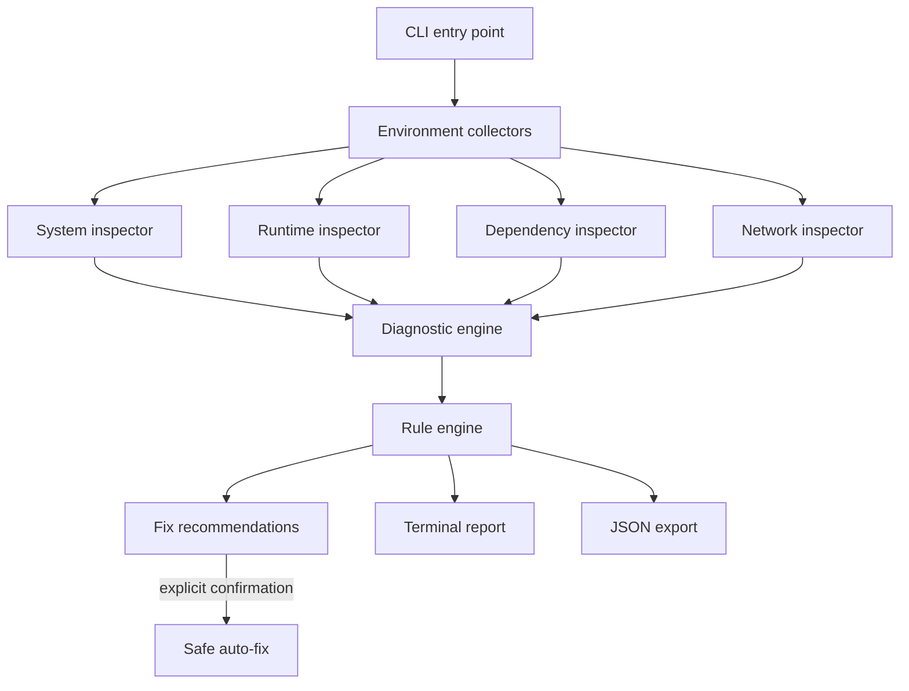

# EnvDoctor

> A cross-platform CLI that detects, diagnoses and helps resolve development environment problems.


[](LICENSE)


**Status: skeleton (v0.0.0).** This repository contains the project structure, architecture decisions and
an implementation plan. **Nothing is functional yet.** The word "works" does not appear below unless it is
true.

## Why this exists

"Works on my machine" is usually a PATH problem, a port conflict, a stale Node version manager,
a Docker daemon that is not running, or a missing system library. Developers lose hours to this and the
existing answers are scattered forum posts. EnvDoctor collects the evidence, applies explicit rules, and
explains the cause instead of dumping raw output.

## What it will do

| Capability | Milestone | Status |
|---|---|---|
| Detect conflicting Python and Node versions | M2 | Not started |
| Identify broken PATH entries | M2 | Not started |
| Detect port conflicts | M2 | Not started |
| Diagnose Docker daemon problems | M3 | Not started |
| Identify missing system dependencies | M3 | Not started |
| Detect incompatible package managers | M3 | Not started |
| Check Git configuration | M2 | Not started |
| Generate diagnostic bundles | M4 | Not started |
| Human-readable reports | M4 | Not started |
| JSON export | M4 | Not started |
| Safe, opt-in automated remediation | M5 | Not started |
| Windows, Linux and macOS support | M6 | Not started |

## Architecture



Full reasoning, data model, API surface and failure behaviour are in [docs/PLAN.md](docs/PLAN.md).

## Engineering challenge

Supporting three operating systems without platform-specific assumptions leaking into the
diagnostic engine. Collectors are platform-specific; rules are not. No rule may shell out to a tool that
might not exist, and no fix may run without explicit confirmation.

## Quickstart

Not runnable yet. The skeleton builds and prints its version:

```bash
make build
./bin/envdoctor version
```

Full local stack (build and test tooling) arrives with
milestone M1.

## Repository layout

| Path | Purpose |
|---|---|
| `cmd/envdoctor` | CLI entry point |
| `internal/collector` | Collector interface and registry |
| `internal/collector/{windows,linux,darwin}` | Platform-specific collectors behind build tags |
| `internal/diagnostic` | Rule engine, severity model, explanation composition |
| `internal/report` | Terminal renderer, JSON renderer, bundle writer |
| `internal/fix` | Remediation plans, dry-run by default |
| `internal/system` | Thin wrappers over OS facilities, the only place syscalls live |
| `tests/golden` | Snapshot-to-diagnosis fixtures, one per rule |
| `deploy` | Release and packaging notes |

## Roadmap

| Milestone | Deliverable | Status |
|---|---|---|
| M1 | CLI foundation, collector interface, system information | Not started |
| M2 | Cross-platform collectors: runtimes, PATH, ports, Git | Not started |
| M3 | Diagnostic rule engine and Docker/dependency rules | Not started |
| M4 | Human-readable reports, JSON export, diagnostic bundles | Not started |
| M5 | Safe, confirmed automated remediation | Not started |
| M6 | Windows, Linux, macOS packaging and signed releases | Not started |

This roadmap mirrors [docs/PLAN.md](docs/PLAN.md) section 12. If the two disagree, the plan is correct and
the README is a bug.

## Project standards

- Conventional Commits, Semantic Versioning, `main` is always green.
- Every release is produced by CI, never by a laptop.
- Status claims must match reality. Unbuilt features are marked "Not started", not "coming soon".
- Decisions are recorded as ADRs in [docs/adr/](docs/adr/).

## Contributing

Read [CONTRIBUTING.md](CONTRIBUTING.md) and [docs/PLAN.md](docs/PLAN.md) first. Issues labelled
`good first issue` are scoped for a first pull request.

## Using an AI assistant on this repository

Read [docs/PLAN.md](docs/PLAN.md) end to end, including the machine context block at the top. It states
what exists, what does not, and which claims are forbidden. Do not describe planned behaviour as
implemented behaviour.

## License

MIT - see [LICENSE](LICENSE).
