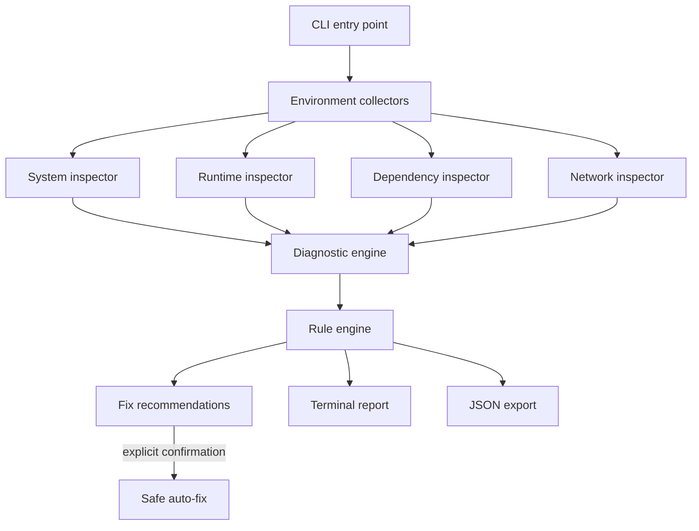

# EnvDoctor

> A cross-platform CLI that detects, diagnoses and helps resolve development environment problems.


[](LICENSE)


**Status: M2 complete (unreleased).** EnvDoctor collects platform, shell, PATH, Python/Node runtime,
requested TCP-port, Git and local Docker facts. Six rules explain conflicts and suggest manual next steps.
Reports are plain text or versioned JSON. Diagnosis never applies fixes or executes interpreters found on PATH.

## Why this exists

"Works on my machine" is usually a PATH problem, a port conflict, a stale Node version manager,
a Docker daemon that is not running, or a missing system library. Developers lose hours to this and the
existing answers are scattered forum posts. EnvDoctor collects the evidence, applies explicit rules, and
explains the cause instead of dumping raw output.

## What it will do

| Capability | Milestone | Status |
|---|---|---|
| Detect conflicting Python aliases and Node candidates | M2 | **Done**, when metadata provides the required evidence |
| Identify broken PATH entries | M2 | **Done** (raw entries preserved after home redaction) |
| Detect requested TCP port conflicts | M2 | **Done**, owner PID/name where permitted |
| Detect unreachable local Docker engine | M2 | **Done** (ENV006) |
| Inspect Docker contexts and version skew | M3 | Not started |
| Identify missing system dependencies | M3 | Not started |
| Detect incompatible package managers | M3 | Not started |
| Collect effective Git identity and autocrlf | M2 | **Done**; Git diagnostic rules are M3 |
| Generate diagnostic bundles | M4 | Not started |
| Human-readable reports | M2/M4 | **Done** plain text; interactive polish is M4 |
| JSON export | M1 | **Done** |
| Safe, opt-in automated remediation | M5 | Not started |
| Windows, Linux and macOS support | M2/M6 | Three-OS code and fixtures; signed release/clean-host verification is M6 |

## Architecture



Full reasoning, data model, API surface and failure behaviour are in [docs/PLAN.md](docs/PLAN.md).

## Engineering challenge

Supporting three operating systems without platform-specific assumptions leaking into the
diagnostic engine. Collectors are platform-specific; rules are not. No rule may shell out to a tool that
might not exist, and no fix may run without explicit confirmation.

## Quickstart

Requires Go 1.26+. From the repository root, in PowerShell:

```powershell
go build -o bin/envdoctor.exe ./cmd/envdoctor
.\bin\envdoctor.exe diagnose
.\bin\envdoctor.exe diagnose --port 3000,8080
```

On Linux/macOS use `go build -o bin/envdoctor ./cmd/envdoctor` and `./bin/envdoctor diagnose`.
Port inspection runs only when you provide `--port`; a listening service is not automatically a conflict.

Try the committed **synthetic** demo without inspecting your machine:

```powershell
.\bin\envdoctor.exe diagnose --fixture-dir tests/demo
.\bin\envdoctor.exe diagnose --fixture-dir tests/demo --rule ENV005
```

The demo intentionally fires all six rules and exits 2. Its port finding includes:

```text
[ERROR] Requested TCP port is already in use

Detected:
  - TCP 3000: demo-node pid 123

Verify:
  envdoctor diagnose --rule ENV005 --port 3000
```

This excerpt was produced by the CLI using `tests/demo/snapshot.json`; its process and paths are examples.
The [validation record](docs/testing/m1-m2-validation.md) also records a real Windows listener test.

Machine-readable output, for an editor or CI:

```bash
./bin/envdoctor diagnose --json
```

The JSON document is validated against [docs/schema/diagnose-v1.schema.json](docs/schema/diagnose-v1.schema.json)
in the test suite; the snapshot inside it is described by
[docs/schema/snapshot-v1.schema.json](docs/schema/snapshot-v1.schema.json). Home directories are replaced
with `~` before anything is written.

Exit codes: `0` nothing at or above warning, `1` warnings, `2` at least one error, `3` the tool itself failed
(including a collector timeout), `4` invalid usage. Captured collector errors retain exit 3 during offline
diagnosis. A degraded report still contains the findings that could be evaluated.

`--component` and `--rule` narrow findings. Collection still covers the full snapshot. `--port` accepts
comma-separated values and repeated flags. `--fixture-dir` reads one version-1 `snapshot.json` up to 8 MiB;
it rejects unknown fields, trailing documents and unsupported versions, and invokes no collectors.

## Implemented rules

| Rule | Evidence and behavior |
|---|---|
| [ENV001](docs/rules/ENV001.md) | Known differing versions for active Python command aliases |
| [ENV002](docs/rules/ENV002.md) | Multiple Node candidates or a missing selected target |
| [ENV003](docs/rules/ENV003.md) | Missing raw PATH entries |
| [ENV004](docs/rules/ENV004.md) | A selected environment shadowed by an earlier runtime |
| [ENV005](docs/rules/ENV005.md) | A requested TCP port held by a listening process |
| [ENV006](docs/rules/ENV006.md) | Installed Docker CLI with an unreachable default local engine |

Runtime versions come from known manager paths, Windows file resources or venv metadata. Unknown versions
stay unknown; Unix system interpreters and opaque manager shims may not provide enough metadata. Expected
targets use `VIRTUAL_ENV`, `NVM_BIN` or `NVM_SYMLINK`. Git/Docker tools are found only in known installation
locations. Docker probes its default local socket rather than a selected remote context.

Home paths are redacted, including quoted paths and error notices. JSON includes Git identity; review it
before sharing. Diagnostic bundles with broader redaction remain M4.

## Testing

```powershell
$env:GOTOOLCHAIN='go1.26.11'
go test -count=1 -timeout=120s ./...
go vet ./...
go build ./...
```

The suite includes 54 exact golden cases: six rules × three OS snapshots × positive/negative/edge cases.
It also builds the CLI and checks those cases through real subprocesses, validating JSON and exit codes.
CI runs the full race-enabled suite on Windows, Ubuntu and macOS. Local Linux race commands and measured
results are in [docs/testing/m1-m2-validation.md](docs/testing/m1-m2-validation.md).

A local release build of all six targets:

```bash
goreleaser build --snapshot --clean
```

`goreleaser check` and the local six-target snapshot build passed. A snapshot build does not publish a release.

## Repository layout

| Path | Purpose |
|---|---|
| `cmd/envdoctor` | CLI entry point |
| `internal/cli` | Command wiring, flags, exit codes |
| `internal/config` | Resolved options, schema version, collector timeout |
| `internal/collector` | Parallel runner and platform/PATH/runtime/port/Git/local-Docker collectors |
| `internal/diagnostic` | Rule engine, severity model, fixture harness |
| `internal/report` | Terminal renderer, JSON renderer |
| `internal/fix` | Remediation plans, dry-run by default (empty until M5) |
| `internal/system` | Thin wrappers over OS facilities, the only place syscalls live |
| `docs/schema` | Committed JSON schemas, enforced by tests |
| `tests/golden` | 54 snapshot-to-diagnosis fixtures |
| `tests/integration` | Built CLI tests against all golden cases |
| `tests/demo` | Synthetic offline snapshot demonstrating all six rules |
| `deploy` | Release and packaging notes |

## Roadmap

| Milestone | Deliverable | Status |
|---|---|---|
| M1 | CLI foundation, collector interface, system information | **Done** (v0.1.0) |
| M2 | Cross-platform collectors and rules ENV001–ENV006 | **Done (unreleased)** |
| M3 | Rules ENV007–ENV012, Docker and dependency inspectors, `explain` | Not started |
| M4 | Polished terminal output, Markdown export, diagnostic bundles | Not started |
| M5 | Safe, confirmed automated remediation | Not started |
| M6 | Windows, Linux, macOS packaging and signed releases | Not started |

This roadmap mirrors [docs/PLAN.md](docs/PLAN.md) section 12. If the two disagree, the plan is correct and
the README is a bug.

## Project standards

- Conventional Commits, Semantic Versioning, `main` is always green.
- Every release is produced by CI, never by a laptop.
- Status claims must match reality. Unbuilt features are marked "Not started", not "coming soon".
- Decisions are recorded as ADRs in [docs/adr/](docs/adr/).

## Contributing

Read [CONTRIBUTING.md](CONTRIBUTING.md) and [docs/PLAN.md](docs/PLAN.md) first. Issues labelled
`good first issue` are scoped for a first pull request.

## Using an AI assistant on this repository

Read [docs/PLAN.md](docs/PLAN.md) end to end, including the machine context block at the top. It states
what exists, what does not, and which claims are forbidden. Do not describe planned behaviour as
implemented behaviour.

## License

MIT - see [LICENSE](LICENSE).
