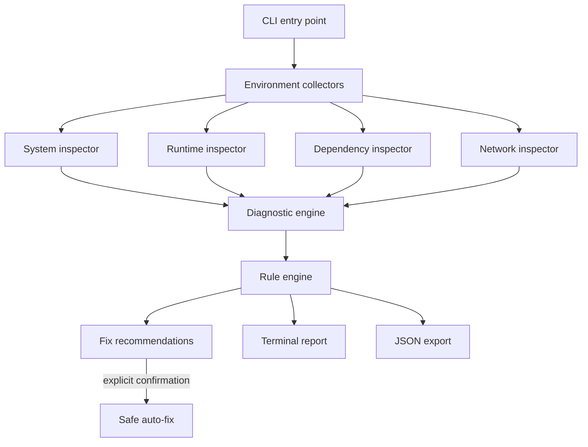

# EnvDoctor Architecture

**Status: M2 complete, unreleased.** Seven collectors feed six pure rules and a plain-text/JSON report.
Dependency inspection, broader Docker rules, bundles, automatic fixes and interactive output remain planned.
The authoritative specification is [PLAN.md](PLAN.md); [ADR 0004](adr/0004-m2-collectors-and-rules.md)
records the implemented evidence and inspection boundaries.

## Context

A cross-platform CLI that detects, diagnoses and helps resolve development environment problems.

"Works on my machine" is usually a PATH problem, a port conflict, a stale Node version manager,
a Docker daemon that is not running, or a missing system library. Developers lose hours to this and the
existing answers are scattered forum posts. EnvDoctor collects the evidence, applies explicit rules, and
explains the cause instead of dumping raw output.

## Intended shape

## Component responsibilities

See [PLAN.md](PLAN.md) section 6 for the responsibility of each box, the request and event flows, and the
failure behaviour of each stage.

The live path runs platform, shell, PATH, runtime, requested-port, Git and local-Docker collectors in
parallel with a two-second deadline. Each returns a typed part; results merge in registration order.
Failed or late results contribute an error rather than partial facts. The runner's wait is bounded even
when a kernel filesystem operation ignores cancellation.

Runtime discovery reads metadata without executing interpreters or shims. Windows uses TCP table and
query-only process APIs, Linux uses `/proc`, and macOS uses a known lsof installation. No port inspection
runs without `--port`. Git and Docker use known absolute CLI locations with fixed arguments, bounded
output and sanitized context overrides. Docker contacts only its default local engine.

After home redaction, rules ENV001–ENV006 use only the snapshot. Rule/component filters affect evaluation,
not collection. Findings are validated, sorted by severity and rendered with evidence, possible cause,
manual next steps and verification commands. Failed collectors disable dependent rules and give exit 3.

The offline path decodes a bounded versioned snapshot and skips collectors, then uses the same redaction,
engine and report. Captured errors retain degraded notices. Both paths write exactly one JSON document
under `--json`. Platform fields may be absent after a failed collector; no facts are invented to fill them.

Home redaction is not an identity/secret scrubber: Git identity is part of the JSON snapshot. The future
bundle feature must define its own sharing policy. No current command applies a fix.

## What is deliberately absent

See [PLAN.md](PLAN.md) section 4 (non-goals). If a component is not on that diagram, it is not part of the
design.
