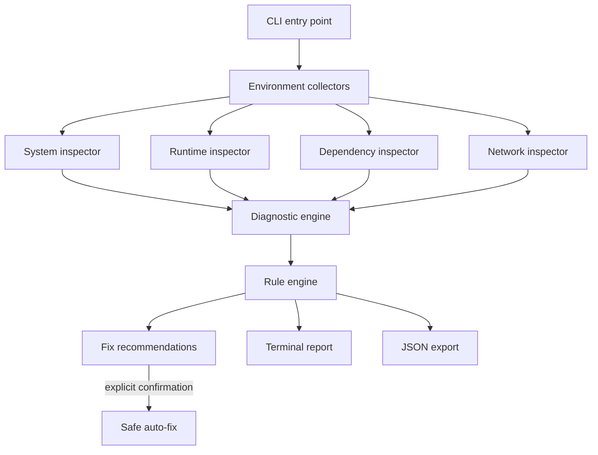

# EnvDoctor Architecture

**Status: partially implemented (M1).** The collector pipeline, platform, shell and PATH collection, and
the JSON contract exist. There are no diagnostic rules yet, so EnvDoctor reports no findings on any machine.
This document describes intended structure, not delivered behaviour. The authoritative specification is
[PLAN.md](PLAN.md), and section 0 there is the current truth.

## Context

A cross-platform CLI that detects, diagnoses and helps resolve development environment problems.

"Works on my machine" is usually a PATH problem, a port conflict, a stale Node version manager,
a Docker daemon that is not running, or a missing system library. Developers lose hours to this and the
existing answers are scattered forum posts. EnvDoctor collects the evidence, applies explicit rules, and
explains the cause instead of dumping raw output.

## Intended shape

## Component responsibilities

See [PLAN.md](PLAN.md) section 6 for the responsibility of each box, the request and event flows, and the
failure behaviour of each stage.

## What is deliberately absent

See [PLAN.md](PLAN.md) section 4 (non-goals). If a component is not on that diagram, it is not part of the
design.
