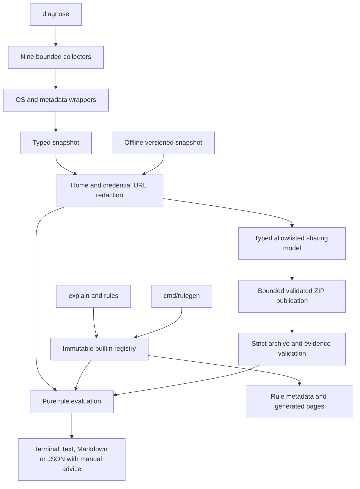

# EnvDoctor Architecture

**Status: M1–M3 merged; M4 implemented and verified, including native three-OS GitHub CI.**
Nine collectors feed twelve pure rules and terminal/plain/Markdown/JSON reports. Offline metadata commands,
generated pages and validated bundle diagnosis share the same registry. Automatic fixes remain planned.
The authoritative specification is [PLAN.md](PLAN.md); [ADR 0005](adr/0005-m3-evidence-and-rule-registry.md)
records the M3 extensions to the M2 evidence and inspection boundaries.

## Context

A cross-platform CLI that detects, diagnoses and helps resolve development environment problems.

"Works on my machine" is usually a PATH problem, a port conflict, a stale Node version manager,
a Docker daemon that is not running, or a missing system library. Developers lose hours to this and the
existing answers are scattered forum posts. EnvDoctor collects the evidence, applies explicit rules, and
explains the cause instead of dumping raw output.

## Implemented flow

## Component responsibilities

See [PLAN.md](PLAN.md) section 6 for the responsibility of each box, the request and event flows, and the
failure behaviour of each stage.

The live path runs platform, shell, PATH, runtime, requested-port, Git, local-Docker, dependency and proxy
collectors in parallel with a two-second deadline. Each returns a typed part; results merge in registration order.
An ordinary error or late result contributes an error rather than facts. Explicit typed partial evidence
can be retained with `Part.Errors`; notices and timings stay degraded and dependent rules are skipped.
The runner's wait is bounded even when a kernel filesystem operation ignores cancellation.

Runtime discovery reads metadata without executing interpreters or shims. Windows uses TCP table and
query-only process APIs, Linux uses `/proc`, and macOS uses a known lsof installation. No port inspection
runs without `--port`. Git and Docker use known absolute CLI locations with fixed arguments, bounded
output and sanitized context overrides. Docker contacts only its default local engine; selected context
metadata and API/host overrides remain evidence, not connection targets. API compatibility uses advertised
bounds and explicit overrides rather than product-version comparisons.

The dependency collector strictly decodes a bounded `envdoctor.requirements.json` and reads optional
`package.json`/lockfile metadata in the working directory. Tool and OpenSSL checks use declared requirements
and file metadata. Explicit `--package-manager` supplies runner evidence; no project scripts are run.
Git records effective identity/config origins, and line-ending advice requires explicit project policy.
Python resolution compares canonical invocation environments, preserving venv/system symlink distinctions.
Unknown shims and protected WindowsApps paths stay inconclusive.

Proxy collection is offline by default and exports only redacted configuration. `--probe-network` permits
at most three distinct configured endpoints, one DNS lookup/one TCP dial each, and a one-second total
deadline. It sends no application bytes and closes each connection. Invalid configuration, denied/DNS/
timeout/cancelled probes degrade collection; refusal/no-route is the conclusive unreachable evidence.

After redaction, rules ENV001–ENV012 use only the snapshot. Rule/component filters affect evaluation,
not collection. Findings are validated, sorted by severity and rendered with evidence, possible cause,
manual next steps and verification commands. Failed collectors disable dependent rules and give exit 3.

The offline path decodes a bounded versioned snapshot and skips collectors, then uses the same redaction,
engine and report. Captured errors retain degraded notices. Both paths write exactly one JSON document
under `--json`. Platform fields may be absent after a failed collector; no facts are invented to fill them.

`explain`, `rules --json` and `cmd/rulegen` use defensive copies of registry metadata without running
collectors. One registry owns finding text, prerequisites, caveats and verification commands.
The generator's check mode is enforced by tests and CI. Optional M3 snapshot fields preserve schema v1;
project and registry JSON have separate version-1 schemas.

Redaction covers home paths and credential-bearing URLs, including errors. Git identity remains part of
the JSON snapshot under the M2 sharing contract. Bundles use the separate M4 sharing policy.
No current command applies a fix.

## What is deliberately absent

See [PLAN.md](PLAN.md) section 3 for non-goals and section 4 for release scope. Rules ENV013–ENV018,
automatic fixes/undo and signed packaging remain later milestones.

## M3 evidence

Read [phase requirements](phases/M3.md), [ADR 0005](adr/0005-m3-evidence-and-rule-registry.md) and
[M3 validation](testing/m3-validation.md) for implemented contracts, tests and limits. Native Windows
and Linux race suites passed locally; native Windows/Ubuntu/macOS tests and race suites also passed in
[M3 CI](https://github.com/Shellghostt/EnvDoctor/actions/runs/43723839978).
[Development tools](DEVELOPMENT-TOOLS.md) records navigation and runtime-profiling coverage.

## M4 report and bundle boundaries

[M4 requirements](phases/M4.md) and [accepted ADR 0006](adr/0006-m4-reports-and-bundles.md) define
Bubble Tea/plain/Markdown output and bounded versioned bundles, implemented at `c532dc3`.
The CLI resolves format conflicts before collection. Automatic viewer selection requires all three
streams to be terminals; explicit formats bypass terminal/environment detection. The report adapter
owns terminal state, output-error cancellation and a joined 200 ms resize poller. Every viewer exit
restores state and writes plain output. Markdown escapes dynamic content and bounds its buffer to 2 MiB.

`internal/bundle` owns selected-file I/O, private temporary staging and same-directory atomic replacement.
These file operations and `internal/report` terminal control are explicit OS boundaries alongside the
existing machine-inspection wrappers. The pure rule engine and sharing-model conversion inspect no host.

The exporter copies reviewed facts into a separate model, substitutes equality/presence aliases and
records fixed omissions. A source-model coverage guard rejects unreviewed collector fields. Bundle
reports are recomputed from sharing evidence. Raw errors/logs/identity and arbitrary original findings
are excluded; optional diagnostics contain only allowlisted statuses/timings.

The reader preflights the complete ZIP directory/local records, bounds streamed Store/Deflate input,
checks CRC/digests and cross-member metadata, then validates exact typed JSON tags and semantic constraints.
Tests compile committed schemas with network loading forbidden. Archives are read without extraction.
Only the sanitized snapshot and provenance reach offline diagnosis; the current registry recomputes
findings. Captured OS normalization preserves ENV011 equality without receiving-host lookups.

Windows publication applies a protected current-user/SYSTEM ACL before writing payload bytes and uses
`MoveFileEx`; Unix uses mode 0600 and rename. Failure paths remove the owned stage and preserve the prior
destination. Atomic namespace replacement assumes a supporting local filesystem; network filesystem
and power-loss guarantees are outside this format.

[M4 validation](testing/m4-validation.md) records native terminal checks, cross-OS captures, bounds,
privacy, lifecycle measurements and passing GitHub CI. Existing collectors, rule pages, 172 golden
fixtures and ordinary JSON/fixture behavior remain compatible.
