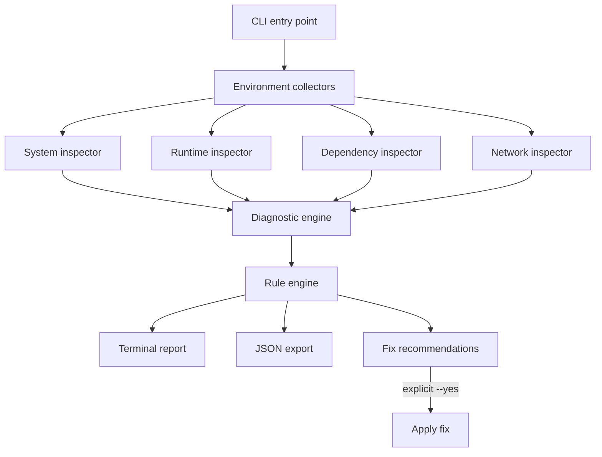

# EnvDoctor — Implementation Plan

> **This file is the specification.** Code follows this document. If a decision here turns out to be wrong,
> write an ADR, then change both.

---

## 0. Machine context

M1–M3 are complete and merged into `main`. [M3 PR #3](https://github.com/Shellghostt/EnvDoctor/pull/3)
merged at `6cf358138ecd3bedf086f22536a30562fb673e4e`; its
[main CI](https://github.com/Shellghostt/EnvDoctor/actions/runs/43802280915) passed.
[ADR 0005](adr/0005-m3-evidence-and-rule-registry.md)
was accepted and committed before implementation. The [M3 requirements](phases/M3.md) define the evidence
and acceptance contract; [M3 validation](testing/m3-validation.md) records the final commands and limits.
The [development-tool audit](DEVELOPMENT-TOOLS.md) records actual coverage and profiling limits.
M4 is **Not started**. [M4 requirements](phases/M4.md) and
[proposed ADR 0006](adr/0006-m4-reports-and-bundles.md) prepare report formats, bundle export/redaction
and offline diagnosis; they do not claim new commands or acceptance results.

```yaml
project: EnvDoctor
status: mvp
version: 0.1.0
builds: true
functional: partial            # M1-M3 collection and twelve rules work; M4-M6 remain

implemented:
  - cobra CLI with diagnose, version, offline explain and rules --json
  - diagnose flags --json, --component, --rule, --verbose, --port, --fixture-dir, --probe-network, --package-manager
  - collector interface, registry and parallel runner with a 2 s per-collector deadline
  - platform collector (OS, version, architecture, elevation) on windows, linux and darwin
  - shell collector (name and path where the shell exposes it)
  - PATH collector with existence, directory, position and duplicate flags
  - runtime metadata discovery for Python and Node, including selected environment targets
  - requested TCP port ownership via OS facilities, effective Git config/origins and local-default Docker probes
  - locally inspected Docker context metadata, advertised API bounds and explicit override evidence
  - explicit project requirements for supported build tools and OpenSSL development files
  - package-manager declaration/runner/lockfile metadata and canonical Python environment evidence
  - redacted proxy configuration and bounded opt-in DNS/TCP reachability
  - pure rules ENV001-ENV012 with manual suggestions and actionable verification commands
  - one builtin rule registry for findings, explain, rules JSON and generated documentation
  - home-path and credential-URL redaction including embedded collector errors
  - text report and a versioned JSON document
  - documented exit codes 0/1/2/3/4
  - compatible snapshot/report schema v1 additions and separate project/registry v1 schemas
  - 172 golden fixtures including the unchanged 54 M2 cases and 118 additional cases
  - built CLI integration tests for the golden cases and JSON/exit-code contracts
  - bounded offline diagnosis that preserves degraded collector errors and rejects live-evidence flags
  - reproducible rule-page generation and a CI documentation drift check
  - goreleaser configuration verified with a local snapshot build of six targets

not_implemented:
  - diagnostic rules ENV013-ENV018
  - markdown report export
  - bubble tea output
  - diagnostic bundles
  - fixes and undo
  - signed releases and install docs
  - --debug-snapshot and --from-bundle

source_of_truth:
  scope_and_rules: docs/PLAN.md      # this file, section 9 for rule ids
  architecture: docs/ARCHITECTURE.md
  decisions: docs/adr/
  rule_fixtures: tests/golden/
  rule_metadata: internal/diagnostic/registry.go
  status: README.md#roadmap

forbidden_claims:
  - "detects every environment problem"
  - "automatically fixes your setup" (fixes are opt-in, previewed, per-rule)
  - support for an operating system not covered by CI
  - any rule that does not exist in section 9

if_uncertain:
  - a rule without a golden fixture is not a rule
  - if behaviour differs per OS, that belongs in a collector, not in a rule
  - never claim a fix is safe without documenting what it changes
```

---

## 1. What this is

A single static binary that inspects a developer machine, applies explicit rules, and explains what is
wrong in language a human can act on.

One-line description: *A cross-platform CLI that detects, diagnoses and helps resolve development
environment problems.*

The differentiator is not detection — anyone can run `python --version`. It is the **explanation**: what was
detected, the most likely cause, the exact fix, and how to verify it worked.

---

## 2. Problem and users

**Problem.** "Works on my machine" is usually one of a dozen boring causes: two Node versions, a PATH entry
pointing at a deleted folder, a port still held by a zombie process, a Docker daemon that is not running, a
missing system library. Finding the cause takes 40 minutes of scattered forum reading. The information needed
to diagnose it is all on the machine already.

**Users.**

| User | Need |
|---|---|
| Developer onboarding to a new repo | "Why doesn't this build?" answered in one command |
| Maintainer triaging an issue | Ask for a diagnostic bundle instead of 12 questions |
| Team lead standardising setups | A shared, reviewable rule set |

**Success looks like.** A developer runs `envdoctor diagnose`, reads four lines, runs the suggested command,
and the build works — without opening a browser.

---

## 3. Non-goals

- **Not a package manager or version manager.** It reports that two Node versions exist; it does not install
  a third.
- **Not a container runtime.** It inspects Docker, it does not replace it.
- **Not a remote agent.** No telemetry, no phone-home, no account. Offline by default.
- **Not an auto-repair tool.** Fixes are explicit, previewed, and never silent.
- **Not a general system monitor.** CPU, RAM and disk trends are out of scope.
- **No GUI.** Terminal first; JSON for editors.

---

## 4. Scope contract

### v0.1 — MVP (M1–M2)

Windows first. `envdoctor diagnose` with 6 rules, human output, `--json`. No fixes.

### v1.0 — public release (M3–M6)

18 rules across Windows, Linux and macOS; explanation engine; diagnostic bundles; opt-in fixes; signed
releases for six platforms.

### Post-1.0

Editor integrations (VS Code problem matcher), `envdoctor watch`, custom rule files, team rule packs,
Homebrew/Scoop/Winget distribution.

---

## 5. Locked decisions

| # | Decision | Rationale |
|---|---|---|
| 1 | Go + Cobra, single static binary | The tool runs on already-broken machines; a Node CLI cannot diagnose a broken Node |
| 2 | Bubble Tea for interactive output | Rich terminal UI without a web stack; falls back to plain text when not a TTY |
| 3 | Collectors are platform-specific, rules are pure | The only way to test three OSes from one CI matrix |
| 4 | Rules are data + a pure function | Enables golden fixtures and a stable rule id contract |
| 5 | No admin rights required | Diagnosis must work for a normal user |
| 6 | Fixes require `--yes` and are never applied silently | A diagnostic tool that breaks a machine is worse than no tool |
| 7 | MIT license | Adoption over patent protection for a utility |
| 8 | JSON is a first-class output, not a debug flag | Editors and CI consume it |

**Rejected alternatives:** Rust (smaller binaries, slower iteration for a solo project), Python (requires
the runtime it is meant to diagnose), a web dashboard (the problem is on the command line), `os/exec` as the
primary inspection method (tools may be absent; OS APIs preferred).

---

## 6. Architecture



### Components

| Component | Responsibility | Must never |
|---|---|---|
| Collector | Read one slice of machine state into a typed snapshot | Interpret, judge, or fix |
| System inspector | Hostname, OS build, arch, shell, elevation, disk | Collect secrets |
| Runtime inspector | Python, Node, Go, Java, Ruby versions and their managers | Modify PATH |
| Dependency inspector | Presence of libraries and build tools | Install anything |
| Network inspector | Listening ports, proxy variables, DNS reachability | Make outbound requests beyond a documented probe |
| Rule engine | Turn a snapshot into findings | Touch the OS |
| Explanation composer | Detected / cause / fix / verify text | Speculate beyond the rule's declared evidence |
| Report renderer | Human text, JSON, diagnostic bundle | Add facts not present in findings |
| Fix engine | Plan, preview, apply, verify a remediation | Run without `--yes` |

### Flow

`envdoctor diagnose` → detect platform → run enabled collectors (parallel, each with a timeout) → assemble
`Snapshot` → run rules that declare compatible components → sort findings by severity → render.

A collector that times out or errors produces a **degraded** snapshot entry, not a crash. Ordinary errors
discard that collector's facts; explicitly typed partial evidence can be retained with `Part.Errors`.
Failed prerequisites disable dependent rules and print a notice. M3 runs nine collectors with a two-second
deadline. Proxy DNS/TCP work requires `--probe-network` and has a one-second total deadline within it.

The builtin registry owns the twelve pure evaluators and their public metadata. Offline `explain`,
`rules --json` and generated rule pages use the same registry without running collectors.

---

## 7. Data model

There is no database. The two persisted artefacts are the snapshot and the report.

**Snapshot** (internal Go struct, JSON-serialisable, redacted before export):

```json
{
  "schemaVersion": 1,
  "collectedAt": "2026-11-13T10:00:00Z",
  "platform": { "os": "windows", "version": "11 23H2", "arch": "amd64", "elevated": false },
  "shell": { "name": "powershell", "path": "C:\\...\\pwsh.exe" },
  "path": { "entries": [ { "raw": "C:\\tools\\bin", "exists": false } ] },
  "runtimes": [
    { "name": "node", "version": "18.19.0", "path": "...", "manager": "nvm", "active": true },
    { "name": "node", "version": "22.11.0", "path": "...", "manager": "system", "active": false }
  ],
  "ports": [ { "port": 3000, "protocol": "tcp", "state": "listen", "pid": 8891, "process": "node.exe" } ],
  "docker": { "cliVersion": "29.9.2", "daemonReachable": false, "context": "desktop-linux" },
  "git": { "version": "2.53.0", "userName": null, "userEmail": null, "autocrlf": "true" },
  "errors": [ { "collector": "docker", "message": "timeout after 2s" } ]
}
```

**Finding**:

```json
{
  "ruleId": "ENV006",
  "severity": "error",
  "component": "docker",
  "title": "Docker daemon unavailable",
  "detected": ["Docker CLI installed (29.9.2)", "Docker daemon not responding", "Port 2375 not reachable"],
  "cause": "Docker Desktop is not running.",
  "fix": {
    "summary": "Start Docker Desktop and retry.",
    "commands": ["Start-Process 'C:\\Program Files\\Docker\\Docker\\Docker Desktop.exe'"],
    "automatic": true,
    "requiresElevation": false,
    "reversible": true
  },
  "verify": "envdoctor diagnose --component docker",
  "docs": "https://github.com/shellghostt/envdoctor/blob/main/docs/rules/ENV006.md"
}
```

**Severity:** `info`, `warning`, `error`, `critical`. Exit code derives from the highest severity present.

The examples above include planned model/fix fields; committed schemas define the implemented contract.
M3 adds optional Docker context/API/state, dependency/package-manager, effective Git-origin, canonical
Python-environment and proxy evidence to snapshot v1. Selected Docker context metadata is distinct from
the `local-default` probe target. Actual findings contain manual suggestions and do not apply fixes or
probe TCP port 2375. See ADRs 0004/0005 and the committed schemas for field and compatibility details.

---

## 8. Command surface and exit codes

```
envdoctor diagnose [--json] [--component <name>] [--rule <id>] [--verbose] [--port <ports>] [--fixture-dir <dir>] [--probe-network] [--package-manager <name>[@<version>]]
envdoctor explain <rule-id>
envdoctor bundle [--output <file>] [--include-logs]
envdoctor fix [--rule <id>] [--dry-run] [--yes]
envdoctor rules [--json]
envdoctor version
```

Implemented as of M3: `diagnose`, `version`, offline `explain` and `rules`/`rules --json`.
`bundle` and `fix` remain planned; see section 0 for the authoritative list. Unknown rule IDs and invalid
metadata arguments exit 4; output failures exit 3.

M4 format/plain/bundle-input flags and bundle command semantics are proposed in
[ADR 0006](adr/0006-m4-reports-and-bundles.md). They are not implemented. Bundle export must use a
separate sharing policy; ordinary JSON continues to include effective Git identity.

| Exit code | Meaning |
|---|---|
| 0 | No findings at or above `warning` |
| 1 | Warnings only |
| 2 | At least one `error` or `critical` |
| 3 | The tool itself failed, including degraded collectors or invalid offline snapshot data |
| 4 | Invalid usage |

`--json` writes exactly one JSON document to stdout and nothing else. All diagnostics and progress go to
stderr. This is a contract: scripts depend on it.

`--port` accepts repeated flags and comma-separated ports 1–65535. TCP listener inspection is skipped
without requested ports. Proxy configuration is collected without network work; `--probe-network` permits
at most three configured endpoints, one DNS lookup/one TCP dial each and a one-second total deadline.
`--package-manager <name>[@<version>]` explicitly selects npm/pnpm/yarn/bun runner evidence.
Both new live-evidence flags are incompatible with `--fixture-dir`.

`--fixture-dir` reads one version-1 `snapshot.json` up to 8 MiB, invokes no collectors,
and rejects unknown fields, trailing documents, unsupported versions and missing capture timestamps.
Captured collector errors still skip their dependent rules and make the run exit 3. Filters narrow findings,
not collection. JSON includes effective Git identity; review reports before sharing them.

`envdoctor.requirements.json` in the working directory supplies strictly decoded version-1 project
requirements (at most 1 MiB and 32 entries) and optional explicit `gitAutocrlf` policy. Initial checks cover
`cmake`, `make`, `gcc`, `pkg-config` on absolute PATH and OpenSSL development files at a declared prefix.
`package.json.packageManager` needs an exact numeric version; installed npm alone never selects a runner.
See [project-v1.schema.json](schema/project-v1.schema.json), [rules-v1.schema.json](schema/rules-v1.schema.json)
and ADR 0005 for precise evidence and unsupported cases.

---

## 9. Rules

Rule ids are stable and never reused. One markdown page per rule in `docs/rules/`.

| ID | Component | Severity | Detects |
|---|---|---|---|
| ENV001 | python | error | Multiple Python installations with conflicting active versions |
| ENV002 | node | error | Multiple Node installations, or version manager shim pointing at a missing version |
| ENV003 | path | warning | PATH entry that does not exist |
| ENV004 | path | warning | PATH shadowing: a different binary earlier in PATH than the expected one |
| ENV005 | network | error | Requested TCP port already in use by a listening process |
| ENV006 | docker | error | Docker CLI present but daemon unreachable |
| ENV007 | docker | warning | Known client/daemon API incompatibility under a documented compatibility policy |
| ENV008 | deps | error | Missing supported tool or OpenSSL files explicitly required at an inspected project location |
| ENV009 | node | warning | Observed lockfiles disagree with a declared/selected package manager, or lockfile families conflict |
| ENV010 | git | warning | Missing effective identity, or `core.autocrlf` conflicting with explicit project policy |
| ENV011 | python | warning | Active virtualenv does not match the interpreter on PATH |
| ENV012 | network | info | Configured proxy unreachable during an explicit opt-in bounded probe |
| ENV013 | system | warning | Low disk space in the working drive |
| ENV014 | deps | warning | Global tool installed but not on PATH |
| ENV015 | node | info | Deprecated or end-of-life runtime version |
| ENV016 | shell | info | Shell profile sets a value that contradicts the current environment |
| ENV017 | docker | warning | Docker context points at a remote host |
| ENV018 | git | info | Repository-local config differs from global identity |

ENV001–ENV012 are implemented; ENV013–ENV018 remain planned. ENV001 requires known differing versions
for active Python aliases. ENV002 reports multiple Node candidates or a missing selected target. ENV004
uses an explicitly selected environment; ENV005 only reports requested ports; ENV006 probes the default
local engine. Runtime versions and unresolved shims may be unknown. ENV007 requires known API bounds or
override evidence; different product versions alone are inconclusive. ENV008 uses explicit supported
project requirements, ENV009 explicit manager/lockfile evidence, ENV010 checked Git identity or explicit
line-ending policy, ENV011 known canonical invocation environments and ENV012 an opt-in conclusive TCP
result. The generated per-rule pages record prerequisites, verification and platform limits.

**Rule contract.** A rule receives the snapshot and returns zero or more findings. It must:

- only use fields its declared components provide;
- never read the environment directly (no `os.Getenv` inside a rule);
- produce deterministic output for the same snapshot;
- include at least one item in `detected` — an explanation with no evidence is a guess.

**Explanation format** (rendered identically in text and JSON):

```
[ERROR] Docker daemon unavailable

Detected:
  - Docker CLI installed (29.9.2)
  - Docker daemon not responding
  - Port 2375 not reachable

Possible cause:
  Docker Desktop is not running.

Suggested fix:
  Start Docker Desktop and retry.

Run:
  envdoctor diagnose --component docker
```

---

## 10. Fix safety model

Rules may propose fixes. Nothing else may.

| Property | Meaning |
|---|---|
| `commands` | Exact commands, shown before execution |
| `automatic` | Whether `envdoctor fix` can perform it without a shell |
| `requiresElevation` | If true, the fix is never applied by the tool; it prints the command |
| `reversible` | If false, `--yes` is not enough; the user must type the rule id to confirm |

**Hard rules:**

1. `envdoctor fix` without `--yes` is a dry run and prints what it would do.
2. A fix that touches PATH, shell profiles or the registry must be reversible and must report the exact lines
   it will add or remove.
3. A fix that requires elevation is never executed. It prints the command.
4. Every applied fix writes a record to `~/.envdoctor/fixes.log` with before/after values, so `envdoctor fix
   --undo <id>` can reverse it.
5. No fix runs during `diagnose`. Ever.

---

## 11. Repository layout

```
envdoctor/
├── cmd/envdoctor/           CLI entry point
├── internal/cli/            command wiring, flags, exit codes
├── internal/config/         resolved options, schema version, timeouts
├── internal/collector/      interface, registry, scheduling
│   ├── windows/             build-tagged collectors
│   ├── linux/
│   └── darwin/
├── internal/diagnostic/     rule engine, severity, explanation composer
├── internal/report/         text, JSON, bundle writers
├── internal/fix/            plan, preview, apply, undo
├── internal/system/         the only package allowed to touch the OS
├── tests/golden/            one fixture per rule
├── tests/integration/       CLI-level tests against fixtures
├── docs/rules/              one page per rule
├── docs/schema/             committed JSON schemas for snapshot and output
└── deploy/                  release notes, goreleaser config
```

---

## 12. Milestones

### M1 — CLI foundation and system information

**Deliverable:** Cobra CLI, config loading, collector interface, system and PATH collectors, `version`,
`diagnose --json` with an empty rule set.

**Acceptance criteria**

- [x] `envdoctor diagnose` prints platform, shell, arch, elevation and PATH health
- [x] `--json` output validates against the documented schema
- [x] Exit code 0 when no rules fire; 3 on collector failure
- [x] Collectors run in parallel with per-collector timeouts
- [x] CI matrix runs on Windows, Ubuntu and macOS from day one
- [x] `goreleaser` produces a Windows binary locally

Status note: verified on Windows 11 with Go 1.27.4. Unit and CLI tests pass; the JSON document was validated
against `docs/schema/diagnose-v1.schema.json` by the test suite. `goreleaser build --snapshot` produced all
six targets. The CI workflow has a three-OS matrix and it has executed: the first run on GitHub on
2026-11-13 passed on Windows, Ubuntu and macOS, including `go test -race`.

### M2 — Cross-platform collectors and first six rules

**Deliverable:** runtime, port, Git collectors; rules ENV001–ENV006; human-readable report.

**Acceptance criteria**

- [x] Node and Python conflicts detected on all three OSes using golden fixtures
- [x] Broken PATH entries reported with the exact raw entry
- [x] Port conflict names the holding process and pid where the OS permits
- [x] Golden fixtures exist for all six rules and run in CI on every platform
- [x] No rule calls `os.Getenv` or executes a binary directly (enforced by a lint test)

Status: complete and merged into `main`. All 54 golden cases passed through both the
engine and a built CLI. Native Windows and Linux race suites passed. A real Windows listening socket was
identified by port, process name and PID. GoReleaser built Windows/Linux/macOS on amd64/arm64; the linter
and vulnerability scanner passed. Main CI
[43554155740](https://github.com/shellghostt/envdoctor/actions/runs/43554155740) passed for the merged baseline.
Cross-compilation is not evidence of native execution. These are merged M2 results;
M3 evidence is recorded below.

Demo: build the CLI and run `diagnose --fixture-dir tests/demo` (synthetic, six findings, exit 2).
See [testing/m1-m2-validation.md](testing/m1-m2-validation.md) for commands, measurements and limitations.

### M3 — Rule engine and dependency rules

**Deliverable:** rules ENV007–ENV012, Docker and dependency inspectors, `explain` and `rules --json`.

Status: **Complete and merged into main**, including native Windows/Ubuntu/macOS CI.
Follow [M3 requirements](phases/M3.md), [ADR 0005](adr/0005-m3-evidence-and-rule-registry.md) and
[M3 validation](testing/m3-validation.md) for evidence, tests and limits.

**Acceptance criteria**

- [x] Docker daemon down is distinguished from Docker not installed
- [x] Missing system library reported only when a project requiring it is detected
- [x] Package manager mismatch detects lockfile vs runner
- [x] `envdoctor explain ENV006` prints the full rule documentation
- [x] Rule pages exist for every rule and are generated from the same source as `rules --json`
- [x] Normal diagnosis and fixtures initiate no remote probes; proxy reachability requires explicit opt-in
- [x] Unknown versions, ambiguous runners, denied/missing evidence and redaction have three-OS fixtures
- [x] `make test`, native Windows/Linux race, `make lint`, build, docs drift and vulnerability checks pass
- [x] The final M3 feature branch passes the Windows/Ubuntu/macOS CI matrix

All 172 fixtures pass through the engine and built CLI. Nine collectors complete real Windows inspection
without degradation; local proxy tests send zero application bytes and release resources. Both macOS
architectures cross-compile. [CI 43723839978](https://github.com/Shellghostt/EnvDoctor/actions/runs/43723839978)
passed native Windows/Ubuntu/macOS race, tests and builds, plus lint and vulnerability scanning.
The validation record names the
tests and records local measurements without claiming M6 clean-host/release coverage.

### M4 — Reports and diagnostic bundles

**Deliverable:** polished terminal output (Bubble Tea when TTY), Markdown export, `bundle` command.

Status: **Not started; documentation prepared.** Follow [M4 requirements](phases/M4.md) and resolve
[proposed ADR 0006](adr/0006-m4-reports-and-bundles.md) before dependent code. Bundle input/export has
its own version/redaction/omission policy; copying the current report is not sufficient.

**Acceptance criteria**

- [ ] Non-TTY output is plain text, stable, and contains no ANSI codes
- [ ] TTY/NO_COLOR/redirect/format and Markdown escaping cases preserve reports/exits and terminal cleanup
- [ ] `envdoctor bundle` produces a versioned zip below 2,000,000 compressed bytes with independent entry/decompression limits
- [ ] Allowlisted export removes synthetic raw environment values, tokens and identities from every member/error path
- [ ] Removed evidence is explicitly omitted/inconclusive; saved report verdicts never override validated captured evidence
- [ ] Cross-OS `diagnose --from-bundle` runs no collectors, commands or network and preserves capture/evaluator provenance
- [ ] Corrupt/traversal/bomb/duplicate/version/oversize archives and atomic write failures are tested
- [ ] M1–M3 golden/JSON/registry/probe regressions and native CI pass, with all M4 evidence recorded
- [ ] One screenshot in the README, taken from a real run

### M5 — Safe remediation

**Deliverable:** `fix` command with dry run, confirmation, apply, verify and undo.

**Acceptance criteria**

- [ ] `fix` without `--yes` changes nothing (test compares filesystem and PATH before/after)
- [ ] Applying a PATH fix is reversible via `fix --undo`
- [ ] Elevation-requiring fixes print the command and never execute
- [ ] Every applied fix is logged with before/after
- [ ] Interrupting a fix mid-way leaves a resumable record and never a half-written profile

### M6 — Three-platform release

**Deliverable:** GoReleaser matrix for six targets, signed checksums, install docs, v1.0.0.

**Acceptance criteria**

- [ ] Binaries for windows/linux/darwin on amd64 and arm64, built by CI only
- [ ] Checksums signed; install instructions tested on a clean VM per OS
- [ ] Binary size under 25 MB per target
- [ ] Full `diagnose` under 3 s warm, 8 s cold, on each platform
- [ ] `CHANGELOG.md` complete; README roadmap all green

---

## 13. Backlog

| ID | Task | Depends | Milestone |
|---|---|---|---|
| ENV-001 | Cobra root, global flags, version | — | M1 |
| ENV-002 | Collector interface, registry, parallel runner with timeouts | — | M1 |
| ENV-003 | Platform + shell collector (three OSes) | ENV-002 | M1 |
| ENV-004 | PATH collector with existence and ordering | ENV-002 | M1 |
| ENV-005 | Snapshot model, JSON schema, redaction pass | ENV-002 | M1 |
| ENV-006 | JSON renderer and exit-code mapping | ENV-005 | M1 |
| ENV-007 | Golden fixture harness | ENV-005 | M1 |
| ENV-008 | CI matrix for three OSes | ENV-001 | M1 |
| ENV-009 | Runtime collector: Python (pyenv, venv, system) | ENV-003 | M2 |
| ENV-010 | Runtime collector: Node (nvm, fnm, volta, system) | ENV-003 | M2 |
| ENV-011 | Port collector | ENV-003 | M2 |
| ENV-012 | Git config collector | ENV-003 | M2 |
| ENV-013 | Rule ENV001 + fixture | ENV-009 | M2 |
| ENV-014 | Rule ENV002 + fixture | ENV-010 | M2 |
| ENV-015 | Rule ENV003 + fixture | ENV-004 | M2 |
| ENV-016 | Rule ENV004 + fixture | ENV-004 | M2 |
| ENV-017 | Rule ENV005 + fixture | ENV-011 | M2 |
| ENV-018 | Rule ENV006 + fixture | ENV-003 | M2 |
| ENV-019 | Terminal renderer with severity grouping | ENV-006 | M2 |
| ENV-020 | Full Docker context/version inspector (local-default probe implemented for ENV006 in M2) | ENV-003 | M3 |
| ENV-021 | Dependency collector (libs, build tools) | ENV-003 | M3 |
| ENV-023A | Opt-in bounded proxy evidence collector and offline-default regression checks | ENV-005 | M3 |
| ENV-022 | Rules ENV007–ENV012 | ENV-020, ENV-021, ENV-023A | M3 |
| ENV-023 | Rule registry, `explain`, `rules --json` and docs generation | ENV-022 | M3 |
| ENV-024 | Bubble Tea/plain selection and escaped Markdown export | ENV-019 | M4 |
| ENV-025 | Versioned bounded bundle writer/reader and allowlisted redaction | ENV-005, ENV-024 | M4 |
| ENV-026 | `diagnose --from-bundle` | ENV-025 | M4 |
| ENV-027 | Fix planner and dry run | ENV-022 | M5 |
| ENV-028 | Fix apply, logging and undo | ENV-027 | M5 |
| ENV-029 | GoReleaser, checksums, signing | ENV-008 | M6 |
| ENV-030 | Install docs and clean-VM verification | ENV-029 | M6 |

---

## 14. Testing strategy

- **Golden fixtures** are the core. Each rule has a snapshot JSON and an expected findings JSON. No rule is
  merged without both.
- **CLI integration tests** run the built binary against a fixture directory (`--fixture-dir`), asserting
  stdout, stderr and exit code.
- **Redaction tests** attempt to leak synthetic credentials through snapshots, findings and notices.
  Bundle sharing/redaction remains a separate M4 acceptance gate.
- **Cross-platform:** the same suite runs on `windows-latest`, `ubuntu-latest`, `macos-latest`. A rule that
  has a platform exclusion records it in registry caveats and explicit inconclusive fixtures.

**Performance targets:** full diagnose < 3 s warm / < 8 s cold; binary < 25 MB; memory < 100 MB; every
collector < 2 s or it is disabled with a degraded notice.

---

## 15. Observability

No telemetry, by design. Diagnostics only:

- `--verbose` prints collector timings; errors are redacted.
- Planned `envdoctor diagnose --debug-snapshot <file>` will write a snapshot for bug reports.
- Planned bundles will include tool version, OS build and collector timings.

There is no `envdoctor.io` endpoint. There is no analytics. A PR that adds phone-home is rejected.

---

## 16. Security and threat model

| Threat | Mitigation |
|---|---|
| Tool leaks secrets into a bundle | Allowlist-based snapshot fields; redaction tests |
| Tool modifies the machine unexpectedly | Fixes require `--yes`; dry run default; undo log |
| Malicious PATH entry executes during collection | Never execute binaries from PATH; use file metadata and OS APIs |
| Bundle used to attack the maintainer | Bundles are data only; `diagnose --from-bundle` never executes anything from the bundle |
| Privilege escalation | The tool never requests elevation; elevated fixes are printed, not run |
| Supply chain | CI-built, checksums signed, `govulncheck` in CI |

Explicitly out of scope: malware detection, host compromise assessment.

---

## 17. Repo conventions

- Commits: `feat(rule): add ENV009 package manager mismatch`
- Every new rule: code + fixture + `docs/rules/<id>.md` + README table row, one PR.
- Never delete a rule id. Deprecate it with `deprecated: true` and a pointer to the replacement.

---

## 18. Risks and open questions

| Risk | Impact | Mitigation |
|---|---|---|
| Three OSes triple the test surface | Slow, flaky CI | Collectors are thin; rules are pure; matrix runs in parallel |
| Version-manager detection is guesswork | False "conflict" findings | Detect only observable facts (paths, shims, env values) |
| Rules rot as tools change | Wrong advice | Each rule page documents the versions it was verified against |
| Users expect auto-fix to be magic | Broken machines | Dry run, explicit confirmation, undo |

**Open questions:**

1. Should `diagnose` exit non-zero by default in CI, or require `--strict`? *Current: non-zero on error, so
   problems are not silently ignored.*
2. How long do fix logs live in `~/.envdoctor/`? *Planned: 90 days, pruned on startup; fixes are M5.*
3. Is a rule registry format needed for team rule packs before v1.0? *Current: no, post-1.0.*

---

## 19. Anti-hallucination contract

**Facts:** M1–M3 collection, twelve pure diagnostic rules, plain-text/JSON reporting, offline metadata
commands and bounded offline diagnosis are implemented and tested. Native Windows/Linux local race
suites and native Windows/Ubuntu/macOS M3 CI pass. Bundles, automatic fixes, rules ENV013–ENV018
and signed releases remain future work. Runtime discovery does not execute PATH candidates and unknown
metadata stays unknown. Optional proxy reachability requires explicit opt-in.

**Rules:**

1. Do not say EnvDoctor "detects" anything until the rule exists **and** has a golden fixture.
2. Do not claim support for an OS that is not in the CI matrix.
3. Do not describe a fix as safe without the four safety properties in section 10.
4. A rule id in documentation that is absent from section 9 is a bug.
5. Update the rule table, README roadmap and CHANGELOG in the same pull request that adds a rule.
6. Never write a finding that has no evidence in `detected`. Guessing is worse than silence.

**Glossary:**

| Term | Meaning |
|---|---|
| Collector | Reads one slice of machine state. Platform-specific. |
| Snapshot | Immutable, typed, redacted view of the machine at one moment. |
| Rule | Pure function from snapshot to findings. Has a permanent id. |
| Finding | One diagnosis: severity, evidence, cause, fix. |
| Fix | A proposed remediation with explicit safety properties. |
| Bundle | Versioned export of redacted captured evidence/reports under a documented sharing policy. |
| Degraded | A collector failed; its rules are skipped, not guessed. |

---

## 20. Handoff protocol

1. Read sections 0, 3 and 9. Ten minutes.
2. `make build && ./bin/envdoctor diagnose`; compare what it prints with section 0's `functional` field.
3. Pick the next unchecked item in the current milestone. Rules come with fixtures or they do not come.
   M4 requirements are in [phases/M4.md](phases/M4.md); ADR 0006 remains proposed. This preparation
   authorizes documents only; implementation needs a later request and accepted export/CLI decisions.
4. Run `make test` — golden fixtures will tell you immediately if a rule change broke another platform.
5. Never add a fix without the safety model. If in doubt, print the command instead of running it.
